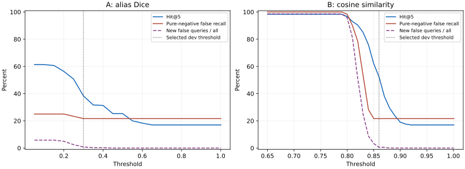

# MEM-5：换个说法也想得起来，两条路实测

本次新盲测的现状命中率为 46.67%，比旧开发集 17% 高，说明它的表达分布更容易被字面链路命中。A 只救回原漏掉 80 问中的 4 问（5%），B 救回 67 问（83.75%），合用救回 68 问（85%）。但 B/合用在 150 条正例中的 73 条夹带了非目标记忆；高命中率同时带来错误上下文。

这次只做实验，**产品召回没有修改**。195 条新合成问句先单独提交，再写实现；150 条正例、45 条负例。开发集选完阈值后，盲测只进行一次最终运行，之后没有改阈值或补规则。以下数字包括原召回已有的命中与错误。

| 路线                 | 没见过的问法：前 5 条命中 | 不相关问句误召 | 原有命中丢失 | 审查：原行为/人物；技术负例 | 开发集典型检索耗时 |
| -------------------- | ------------------------: | -------------: | -----------: | --------------------------- | -----------------: |
| 现状                 |                    46.67% |         28.89% |            0 | 8/8；10/10                  |       中位 1.11 ms |
| A：形成时写主题/别名 |                    49.33% |         31.11% |            0 | 8/8；9/10                   |       中位 1.35 ms |
| B：本机按意思找      |                    91.33% |         40.00% |            0 | 8/8；10/10                  |       中位 3.64 ms |
| A+B 合用             |                    92.00% |         40.00% |            0 | 8/8；9/10                   |       中位 3.58 ms |

A 查询时无需常驻模型、不发云请求。另发一次生成旁注的办法，每 1,000 条约 ¥0.25（按未缓存单价）；一起放进已有形成请求，12 组配对实测的增量约 ¥0.29/1,000 条。形成时内容会发给云端 MiMo，本次发送的全是合成内容。旧记忆没有旁注就保留原行为；回填会产生同样的生成用量。
B 没有云端词元费用，记忆和问句在本机处理。权重 118.3 MB，含分词器等下载约 135.9 MB；加载 0.90 秒，进程加载后常驻内存约 476 MB。要保持毫秒级查询需要常驻模型；临时加载会再付加载时间。每条向量的纯数据 1,536 字节。A+B 同时承担两种生成与存储成本。
隔离 SQLite（嵌入式数据库）侧表实测每 1,000 条多占：A 约 0.18 MB，B 约 2.05 MB。B 在 50,000 条上的纯向量搜索中位约 3.05 ms，但当前真实整条链路单次约 448.3 秒，仍需正式的候选接口解决整库扫描。

**建议两条都暂不直接上线。** A/合用未通过全部技术负例；B 通过 18 条必过探针，却在审查正例新增两次非目标返回，在盲测 195 问中有 91 问带了错误记忆。B 可以作为下一轮候选质量研究的主线，但需要能识别查询对象/用途的通用相关性判断，再用新的独立盲测验证；不能给失败问句逐条加词表。A 保留为来源受控的主题线索辅助，单独依靠它救回的盲测漏项有限。

A 开发 / 盲测前 5 条命中为 38.33% / 49.33%，差 +11.00 个百分点。
B 开发 / 盲测前 5 条命中为 52.33% / 91.33%，差 +39.00 个百分点。
AB 开发 / 盲测前 5 条命中为 62.00% / 92.00%，差 +30.00 个百分点。
两套合成数据的主题与句式不同，盲测由模型作者标注，缺少人工裁决；这些数字不能外推成本人的真实记忆命中率。若开发明显高而盲测下降，应作为过拟合证据，不用开发分数做宣传。本次没有真实数据上传或真实库验证。
B 的开发所有问句误召只有 5.56%，盲测却是 46.67%；开发新增错误预算并未迁移到新分布。**所选阈值对开发分布过拟合**，即使命中率在更易匹配的新集合上更高，也不能据此说泛化可靠。A 对应为 5.83% / 12.82%。

## 方法、冻结与原链路

盲测冻结提交 `c30f14b`，参数和实现冻结提交 `5f16102`，产品基于 `dc780326`。原开发/挑战/保留/审查四份都已暴露；只有开发用于选阈值，原四份全量回归 638 问仍与基线逐条一致。
候选先在临时合成库上算分，再交给原 `_current_world_rows`、原 `_match_world_rows` 的更正/历史/名称规则，并在最后调用原 `world_item_visible`。原 `QueryService`、快照、权限、账号、遗忘、过期和渲染全程保留。原命中按原顺序排在新增候选前；因此同时保留原有错误，并不声称修复了基线误召。
A 用 MiMo 从记忆本身生成最多八个别名，没有看问句；中文双字/英文整词 Dice（重叠系数）最大匹配。B 使用本机 multilingual-e5-small、384 维归一化向量、余弦相似度；纯 CPU（中央处理器）、两个线程，不请求本机端口、不启动显卡服务。合用版本取候选并集，阈值没有再调。
每份集合的正例数用于 Hit@1/3/5（前 1/3/5 条命中率）的分母；纯负例误召以该集合没有目标的问句为分母。另报所有问句的非目标误召，避免只看纯负例掩盖正例夹带错误。开发集一个事实有多个改述，样本相关；新盲测每场景只一个问句。

## 三份集合的数字

表中 baseline（现状基线）使用未修改的产品召回。所有百分比的分母列在集合名称中。

| 集合（正/负）  | 路线     |   前 1 |   前 3 |   前 5 | 纯负例误召 | 所有问句误召 | 新增错误问句 | 原命中丢失 |
| -------------- | -------- | -----: | -----: | -----: | ---------: | -----------: | -----------: | ---------: |
| 开发（300/60） | baseline | 17.00% | 17.00% | 17.00% |     21.67% |        5.00% |            0 |          0 |
| 开发（300/60） | A        | 38.33% | 38.33% | 38.33% |     21.67% |        5.83% |            3 |          0 |
| 开发（300/60） | B        | 52.00% | 52.00% | 52.33% |     21.67% |        5.56% |            2 |          0 |
| 开发（300/60） | AB       | 61.67% | 61.67% | 62.00% |     21.67% |        6.11% |            4 |          0 |
| 盲测（150/45） | baseline | 46.00% | 46.67% | 46.67% |     28.89% |       12.31% |            0 |          0 |
| 盲测（150/45） | A        | 47.33% | 49.33% | 49.33% |     31.11% |       12.82% |            1 |          0 |
| 盲测（150/45） | B        | 87.33% | 91.33% | 91.33% |     40.00% |       46.67% |           68 |          0 |
| 盲测（150/45） | AB       | 87.33% | 92.00% | 92.00% |     40.00% |       46.67% |           68 |          0 |
| 审查（28/10）  | baseline | 28.57% | 28.57% | 28.57% |      0.00% |        0.00% |            0 |          0 |
| 审查（28/10）  | A        | 42.86% | 42.86% | 42.86% |     10.00% |        2.63% |            1 |          0 |
| 审查（28/10）  | B        | 53.57% | 53.57% | 53.57% |      0.00% |        5.26% |            2 |          0 |
| 审查（28/10）  | AB       | 57.14% | 57.14% | 57.14% |     10.00% |        7.89% |            3 |          0 |

审查必须保留的 4 条原行为与 2 个人物名称 × 2 个权限层，共 8 条正例，单独计数；10 条技术负例必须每条空结果。

| 路线     | 4 条原行为 | 4 条名称 | 10 条技术负例空结果 | 审查新增错误问句 | 全部必过项 |
| -------- | ---------: | -------: | ------------------: | ---------------: | ---------- |
| baseline |        4/4 |      4/4 |               10/10 |                0 | 通过       |
| A        |        4/4 |      4/4 |                9/10 |                1 | 未通过     |
| B        |        4/4 |      4/4 |               10/10 |                2 | 通过       |
| AB       |        4/4 |      4/4 |                9/10 |                3 | 未通过     |

原始审查失败示例：A 把 `running process怎么停止？` 召回成个人活动记忆；B 在 `吃苹果时怎么用手机记录？` 命中原目标的同时夹带一个干扰项，`subway出行怎么安排？` 返回共享库里另一条事实。这些失败没有用词表或调高阈值补救。B 虽然 18 条必过探针都满足，审查回归仍因新增非目标返回不合格。

盲测新增技术多义词负例共 15 条：

- baseline：0/15 误召（0.00%）。
- A：0/15 误召（0.00%）。
- B：1/15 误召（6.67%）。
- AB：1/15 误召（6.67%）。

每条样本的候选、排名、非目标、类别及原始耗时见 `results/development.json` 与 `results/final.json`。没有删除失败样本、改标签或修改原回归门。
保存的 `lifecycle_leaks` 指标将生命周期类问句的任何返回都计入：B/合用盲测各有 2 问返回无关但 active 的干扰项。它们是相关性错误，不是屏蔽记录泄漏。最终只读审计 `results/derived-audit.json` 按保存结果与状态逐条核对：所有集合、所有路线实际返回被屏蔽记录都是 0；没有重跑盲测或修改原指标。独立强制候选测试覆盖十类屏蔽状态。

## 阈值与误召曲线

只在开发集扫描：A 每 0.05 一档，B 每 0.01 一档。允许最多 3/360 个新增非目标误召问句，但不允许纯负例增加误召、已有命中丢失或生命周期泄漏。按前 5 条命中最多选择，并列先少误召再取较高阈值。最终 A=0.30、B=0.86；选择规则和完整每档指标在 `results/parameters.json`、`results/development.json`。
图中的纯负例错误率包含基线的 13/60 个错误；虚线表示新增错误问句占所有问句的比例，避免基线错误遮住新增风险。没有在盲测上重新扫阈值。

| B 余弦阈值 | 开发前 5 条命中 | 开发纯负例误召 | 新增错误问句 |
| ---------: | --------------: | -------------: | -----------: |
|      0.650 |          98.33% |        100.00% |      355/360 |
|      0.700 |          98.33% |        100.00% |      355/360 |
|      0.750 |          98.33% |        100.00% |      355/360 |
|      0.800 |          96.67% |         98.33% |      345/360 |
|      0.850 |          62.00% |         21.67% |       12/360 |
|      0.860 |          52.33% |         21.67% |        2/360 |
|      0.900 |          19.00% |         21.67% |        0/360 |
|      0.950 |          17.00% |         21.67% |        0/360 |
|      0.990 |          17.00% |         21.67% |        0/360 |
|      1.001 |          17.00% |         21.67% |        0/360 |

## 成本、速度、内存和旧库

测量环境：AMD Ryzen 7 9700X 8-Core Processor，8 核 / 16 逻辑处理器，Microsoft Windows 11 专业版；ONNX（开放神经网络交换格式）仅用两个 CPU 线程。机器为共享工作环境，完整链路先基线后 B，仅一次成对观察，缓存和其他任务可影响结果；不根据这些单次时间宣称 B 比基线更快或更慢。

小库质量评测的完整链路耗时，含连接、当前状态、候选计算、原过滤、最近 Evidence、待更正信息和渲染；A 不计算向量，B 每次实算问句向量，没有问句向量缓存。开发集每问三次，最终盲测/审查每问一次，另有只读校验调用；共享电脑上的延迟仅作描述。

| 集合 | 路线     | 中位 ms | p95（第 95 百分位）ms |
| ---- | -------- | ------: | --------------------: |
| 开发 | baseline |   1.106 |                 1.508 |
| 开发 | A        |   1.351 |                 2.170 |
| 开发 | B        |   3.635 |                 4.882 |
| 开发 | AB       |   3.577 |                 4.586 |
| 盲测 | baseline |   1.675 |                 2.233 |
| 盲测 | A        |   1.712 |                 2.213 |
| 盲测 | B        |   4.531 |                 6.221 |
| 盲测 | AB       |   4.831 |                 6.327 |
| 审查 | baseline |   1.819 |                 2.736 |
| 审查 | A        |   2.348 |                 3.556 |
| 审查 | B        |   4.570 |                 6.312 |
| 审查 | AB       |   5.190 |                 8.098 |

B 逐条写入编码实测 100 条：中位 2.331 ms，p95 3.286 ms；问句编码实测 60 条：中位 3.591 ms。批量 16 条编码回填实测 1,000 条 1.220 秒。

| 记忆数 | 纯向量检索中位/p95 ms | 加问句编码的平均 ms | 原完整链路基线/B ms（单次） | B 回填秒（1,000 实算，其余估计） | 别名额外库大小 | 向量额外库大小 |
| -----: | --------------------: | ------------------: | --------------------------: | -------------------------------: | -------------: | -------------: |
|  1,000 |           0.025/0.089 |               3.817 |                 170.7/124.9 |                             1.22 |        0.18 MB |        2.05 MB |
| 10,000 |           0.251/0.542 |               4.005 |               6464.8/7069.3 |                            12.20 |        1.81 MB |       20.53 MB |
| 50,000 |           3.047/3.788 |               6.848 |           407105.5/448345.5 |                            60.99 |        9.05 MB |      102.65 MB |

纯向量报告是预载矩阵的精确余弦点积与前 32 条排序，1 万/5 万由 1,000 个实算向量平铺；它测容量和内存带宽，不测大库质量，也不含权限过滤。完整链路表在真实临时 World/Evidence 中播种全部条目，每规模只有一个基线/B 成对观察，不给 p95 保证。原链路逐条扫描和前项查询仍可能主导大库延迟；本包不修产品性能，也没有把矩阵耗时冒充最终召回耗时。
存储是隔离 SQLite（嵌入式数据库）表的文件差值，含页开销；向量 float32（32 位浮点数）每条原始 1,536 字节，别名按开发集旁注循环。真实落库还要版本、来源、账号、模型信息、更新/删除记录，因此不能把这份侧表估计当作最终数据库迁移成本。
A 无旁注旧记忆完全回到原行为；独立回填约每千条一个千次请求，费用见上面的未缓存估计，速度受 MiMo 延迟与并发限制。B 未回填旧记录保留原字面路径；后台只对权限允许的记忆实算向量并记录进度，换模型/维度需重新回填。计时按合成短句，较长记忆、更低功耗 CPU 和并发负载需要另量。
A 独立生成旁注的实测请求中位 2.711 秒，p95 7.214 秒（6 并发、含排队/网络）。平均每条输入 138.5、输出 55.7 词元；1,000 条旧记忆回填约 1,000 请求、输入 138461、输出 55724 词元。旁注原始 UTF-8 JSON（通用数据交换格式）平均 184.8 字节，不含来源与版本元数据。

## MiMo 实测用量

| 用途                                                                                                                                                                                                                                                                               | 请求数 | 输入词元 | 输出词元 | 备注                                           |
| ---------------------------------------------------------------------------------------------------------------------------------------------------------------------------------------------------------------------------------------------------------------------------------- | -----: | -------: | -------: | ---------------------------------------------- |
| 独立盲测作者                                                                                                                                                                                                                                                                       |     16 |     4822 |    16291 | 含数量不足后固定结构补齐的请求                 |
| A 开发旁注                                                                                                                                                                                                                                                                         |    191 |    25386 |     9205 | 每个不同合成记忆一次请求；失败旁注计费后退为空 |
| A 最终旁注                                                                                                                                                                                                                                                                         |    638 |    89398 |    36990 | 每个不同合成记忆一次请求；失败旁注计费后退为空 |
| 真实形成提示词 现状                                                                                                                                                                                                                                                                |     12 |    55493 |      796 | 12 个认知，12 个输入                           |
| 真实形成提示词 追加旁注                                                                                                                                                                                                                                                            |     12 |    57641 |     1452 | 12 个认知，12 个输入                           |
| 早期生成器有两次开发中断：独立作者第一次 5 请求的词元未保留；A 初版要求最多八个别名而断言中断，三个完成旁注的用量已进入开发表，其余已发出请求数/词元没有完整日志，不能给整个包精确总账。之后在解码前记录每次请求用量，并采用有界处理。上表是可复核的请求/词元，不将未知项计为零。  |
| 可追溯请求合计 869 次、输入 232,740、输出 64,734 词元；另有上述早期未知项，不声称这是整个包的精确总请求或总花费。                                                                                                                                                                  |
| 开发和最终旁注合计已记录 829 条，按实际返回的缓存词元估算 ¥0.155932；按全未缓存估算 ¥0.207174。两者均为估算而非账单。形成配对实测多出输入 2148、输出 656 词元，增加请求数为 0。                                                                                                    |
| 价格在 2026-10-11 从 [MiMo 官方按量计费文档](https://mimo.mi.com/static/docs/price/pay-as-you-go.md)读取：mimo-v2.6-flash 输入/缓存输入/输出分别 ¥1/¥0.02/¥2 每百万词元。回填通常仍多出一次请求；一起形成的 ¥0.29 仅是本次十二对短句估计，已有形成输出、缓存与模型决策会影响增量。 |

## 开源模型来源与许可

[intfloat/multilingual-e5-small 发布者模型文件](https://huggingface.co/intfloat/multilingual-e5-small/tree/614241f622f53c4eeff9890bdc4f31cfecc418b3/onnx)，固定版本 `614241f622f53c4eeff9890bdc4f31cfecc418b3`，MIT 许可见 [发布者模型卡](https://huggingface.co/intfloat/multilingual-e5-small/blob/614241f622f53c4eeff9890bdc4f31cfecc418b3/README.md)。使用原发布者量化文件，不执行远程代码，不安装/启动任何服务。下载文件只在 `.local/`；中文和英文使用同一个模型，query/passage 前缀、池化、归一化和每个文件的散列均记录在 `results/scale.json`。

## 真要落地还需做什么

- A：在现有来源受控的主题别名机制上明确扩展字段契约，区分等价别名与上位概念；验证生成失败、身份名称、否定与权限变化；用同请求生成代替本次独立请求时，再验证是否改变形成认知。扩展信封目前不被真实编译器接受，本包没有加字段或迁移。
- B：需要正式的候选提供接口，让向量索引先取候选、原过滤最后逐个校验，避免本次评测挂接仍走整库扫描；接口须保留当前更正/历史/人物规则。未自行增加产品挂接点。CPU 模型加载、按账号隔离、索引版本、删除与权限撤销、向量清理、回填、崩溃恢复和磁盘占用均需产品实现与验证。
- A+B：需要统一分数/重复候选策略与新增误召预算，不能直接把两个集合相加后宣称安全；本次保留原候选的并集已经给出实测。
- 多义词：用通用、可评估的相关性或查询意图方法解决，再生成另一份独立盲测。不得围绕审查失败词补手写词表，也不得把已公开盲测重新当盲测。

## 验证与遗留

- `npm ci --no-audit --no-fund`、`uv sync --extra dev`，实验依赖仅在 `.local/mem5/venv`，产品依赖文件不改。
- 按本 Core 仓库 `.github/workflows/ci.yml` 的命令验收；编排规则中 WeftMate 专用的 required/vendor 脚本不属于本仓库，没有跨目录运行或改动 WeftMate。
- CI（持续集成）同命令：`npm run test:coverage` 636/636；`uv run pytest -q` 1,928/1,928；`npm test --workspaces --if-present` 817/817（含根 636，与前面的根测试重复，不能相加成独立总数）。
- `npm run typecheck`、各工作区 `npm run typecheck --workspaces --if-present`、`uv run mypy --strict src tests`（223 个文件）通过。各工作区构建、lint、format、API 快照、共享资产、文档链接、发行版烟测通过。
- `uv run python ../bench/recall-quality/evaluate.py --check --exact-baseline --repeats 3`：638 问，四份集合逐条一致，回归门通过。
- `test_routes.py` 6/6：强制候选后十类屏蔽状态不泄漏、更正前项不返还、人物名称和原顺序保留、无旁注回退、异常后恢复挂接、A 不调用嵌入模型。

重活占用按顺序：第 1 次 Core coverage（覆盖率测试），第 2 次完整 Python，第 3 次工作区完整测试；第 4–6 次开发实验（前两次分别遇到别名数量断言、临时连接未关，最后一次完成），第 7 次固定阈值重计时；第 8 次最终盲测/审查，第 9 次矩阵/回填/存储，第 10 次真实完整链路容量。记录见 `results/verification.json`。每段占一个原子名额，结束/失败都在 finally 释放；无同包并行重活。机器上没有启动大模型、显卡任务或长期服务。

遗留：模型作者标签未人工裁决；早期中断调用日志不全；质量大库/真实记忆分布未验证；容量完整链路每规模只有一次成对观察；回填大规模时间是估计；新相关性判断、产品候选接口和派生数据生命周期尚未实现。

已清理进程：0。所有已启动执行会话正常退出，无需强杀；交付前再检查本包路径和创建时间对应的残留。

云端检查与合 main 后复验见交付追加记录。
